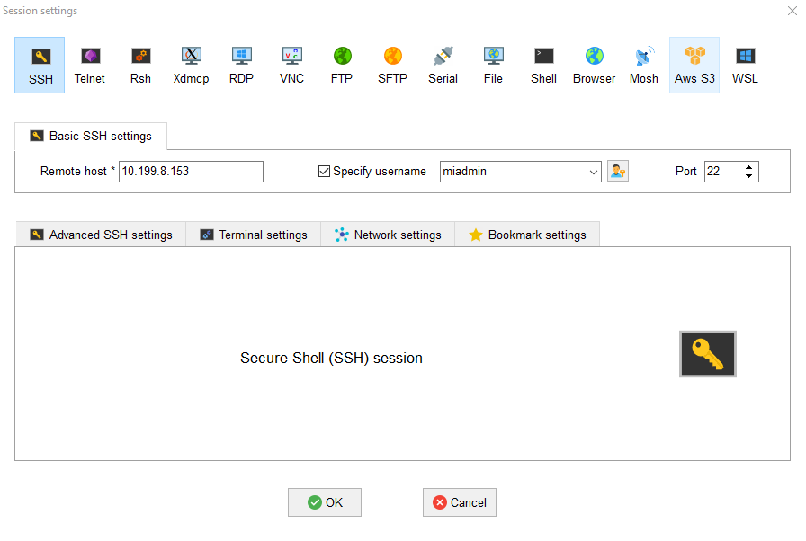
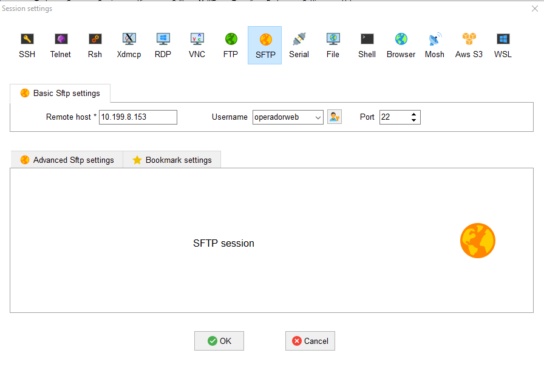
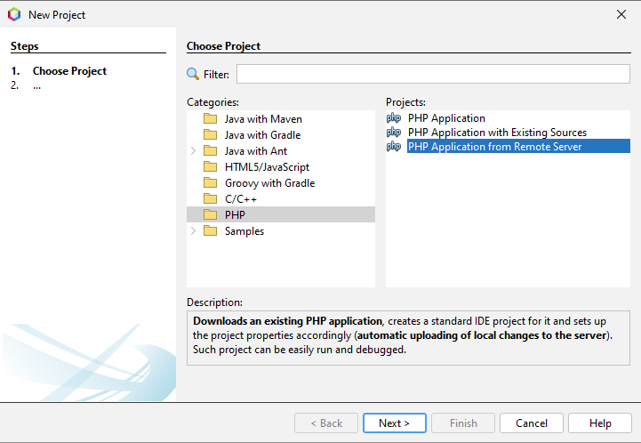
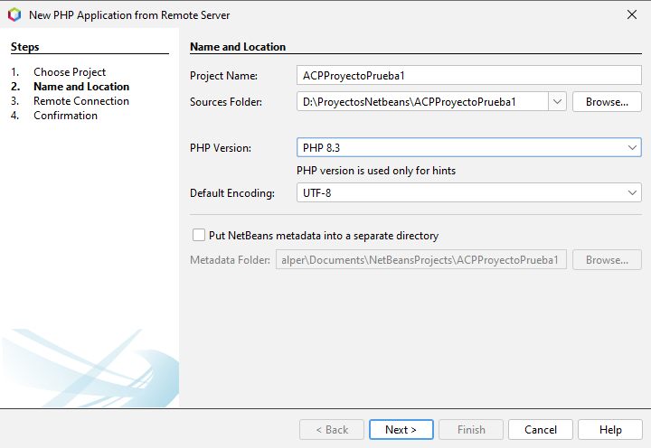
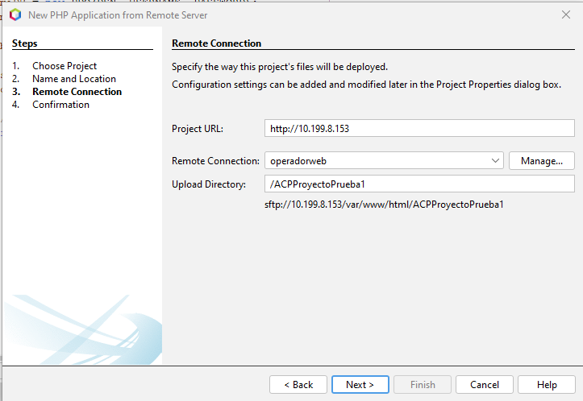
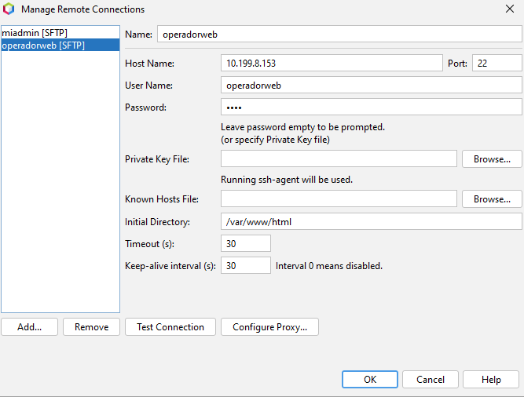

- [CLIENTE DE DESARROLLO - WINDOWS 10/11](#cliente-de-desarrollo---windows-1011)
  - [**1 Configuración inicial**](#1-configuración-inicial)
  - [**2 Navegadores**](#2-navegadores)
  - [**3 MobaXterm**](#3-mobaxterm)
    - [*Instalación*](#instalación)
    - [*Configuración*](#configuración)
    - [*Ejemplo de uso*](#ejemplo-de-uso)
      - [**Conexion SSH**](#conexion-ssh)
      - [**Conexión SFTP**](#conexión-sftp)
  - [**4 Netbeans**](#4-netbeans)
    - [*Instalación*](#instalación-1)
    - [*Configuración*](#configuración-1)
    - [*Ejemplo de uso*](#ejemplo-de-uso-1)
    - [Administración de la base de datos](#53-administración-de-la-base-de-datos)
    - [Conexión al repositorio y versionado (Git)](#54-conexión-al-repositorio-y-versionado-git)
  - [**5 Visual Studio Code**](#5-visual-studio-code)
    - [*Instalación*](#instalación-2)
    - [*Configuración*](#configuración-2)


## <h2>**1 Configuración inicial**</h2>

Como estamos en el dominio de la Junta hay poco que explicar, tenemos Windows 10 con 16 GB de RAM.

## <h2>**2 Navegadores**</h2>
De nuevo, como estamos en el dominio de la Junta esto será breve.       
La cuenta administradora es inaccesible para nosotros así que solo tenemos una cuenta de desarrollador, la nuestra propia, en mi caso es alvaro.calper.    

## <h2>**3 MobaXterm**</h2>

### <h2>*Instalación*</h2>
https://mobaxterm.mobatek.net/download-home-edition.html

Lo descargamos de la página oficial, tenemos dos versiones, una portable y otra para instalar, yo uso la portable.

### <h2>*Configuración*</h2>

### <h2>*Ejemplo de uso*</h2>

#### **<h3>Conexion SSH</h3>**
Damos al icono de *Session* arriba a la izquierda, elegimos SSH y configuramos ip y nombre de usuario.     

Damos al icono de *Session* arriba a la izquierda, elegimos SSH y configuramos ip y nombre de usuario.

Le damos a OK y nos pedirá la contraseña para conectarse.

Si es la primera vez que configuramos una sesión no ssaldrá otra ventana para guardar las contraseñas, si aceptamos nos pedira que pongamos una contraseña general para el programa, si no aceptamos tendremos que poner la contraseña cada vez que nos conectemos.

Nos conectamos seleccionando en la lista de *User sessions* y se abrirá una consola lista con nuestro usuario para poner comandos
````Bash
miadmin@acp-used:~$
````

#### **<h3>Conexión SFTP</h3>**
Damos al icono de *Session* arriba a la izquierda, elegimos SFTP y configuramos ip y nombre de usuario.    

Damos al icono de *Session* arriba a la izquierda, elegimos SFTP y configuramos ip y nombre de usuario.

Le damos a OK y nos pedirá la contraseña para conectarse.

Una vez configurado saldra en la lista de *User sessions* para poder usarlas.

Lo seleccionamos en la lista y se abrirá una ventana con la parte local a la izquierda para buscar los archivos que queremos subir y la parte del servidor a la derecha donde tenemos iconos para ir **arriba**, **actualizar**, **crear carpetas**, **crear archivos**, **abrir carpeta**, **borrar elementos**, **subir archivo** (se abre el explorador de windows para elegir un archivo), **descargar archivo** (seleccionamos un archivo, le damos al boton y se abre el explorador de windows para elegir donde guardarlo) y la barra que indica la ruta donde estamos.

También podemos abrir cualquier archivo de texto, html, php, etc (con doble click) con el editor de texto de MobaXterm por si tenemos que hacer alguna modificación menor o ver el código.

## <h2>**4 Netbeans**</h2>

### <h2>*Instalación*</h2>
Apache NetBeans IDE 20

### <h2>*Configuración*</h2>
- configurar carpetas por defecto, cambiar las rutas

### <h2>*Ejemplo de uso*</h2>
- version y plugins de netbeans (las que esten por defecto, donde se ve)
- como usar github
- como llevar a casa y volver a usar aquí (es github)
- capturas solo de la parte ineteresada, no de toda la pantalla

**<h3>Crear proyecto con conexion (SFTP) al servidor</h3>**
- Nuevo proyecto PHP marcando la opción "PHP Application from Remote Server"    


- Ponemos nombre de proyecto y cambiamos la ruta por la nuestra personal   


- Configuramos la url con nuestro servidor y el nombre del proyecto en el servidor, en el caso del proyecto principal no tiene carpeta es la raíz (/)     


- La primera vez que creamos un proyecto con conexión al servidor hay que configurarlo con nombre de usuario, contraseña y directorio inicial     

- Nuevo proyecto PHP marcando la opción "PHP Application from Remote Server"

- Ponemos nombre de proyecto y cambiamos la ruta por la nuestra personal

- Configuramos la url con nuestro servidor y el nombre del proyecto en el servidor, en el caso del proyecto principal no tiene carpeta es la raíz (/)

- La primera vez que creamos un proyecto con conexión al servidor hay que configurarlo con nombre de usuario, contraseña y directorio inicial

- Si todo ha ido bien se conectará al servidor y entrará en la carpeta del proyecto que previamente tenemos que haber creado y que haya por lo menos un archivo en ella. Aquí ya marcamos para que se bajen los archivos que queramos.

**<h3>Borrar proyecto con conexion (SFTP) al servidor</h3>**
- botón secundario sobre el proyecto y delete. Nos pedirá confirmación y si queremos que borre los archivos en nuestro ordenador. Los del servidor lo tenemos que borrar a mano.
### Administración de la base de datos
NetBeans permite administrar de forma remota bases de datos MySQL/MariaDB directamente desde el IDE, facilitando la ejecución de scripts SQL y la visualización de tablas sin necesidad de cambiar a phpMyAdmin o a la consola.

**Pasos para configurar la conexión:**
1. Ve a la pestaña **Services** (Servicios) ubicada en el panel lateral izquierdo junto a la de *Projects*.
2. Despliega el nodo **Databases** (Bases de datos).
3. Haz clic derecho sobre **Databases** y selecciona **New Connection...** (Nueva conexión).


4. En el desplegable de drivers, selecciona **MySQL** o **MariaDB** y haz clic en *Next*. (Previamente descargar el plugin correspondiente a la base de datos).

5. Rellena los datos de tu servidor:
   * **Host:** Introduce la IP de tu servidor Ubuntu (ej. `10.199.8.153`).
   * **Port:** `3306` (el puerto por defecto de MariaDB).
   * **Database:** Puedes dejarlo en blanco o poner el nombre de una base específica si ya está creada.
   * **User Name:** El usuario administrador de la base de datos que creaste (ej. `adminsql`).
   * **Password:** La contraseña de ese usuario (ej. `paso`). Marca la casilla "Remember password".

6. Haz clic en el botón **Test Connection**. Si la configuración remota (bind-address en Ubuntu y puertos de UFW) es correcta, aparecerá el mensaje de éxito.
7. Haz clic en **Finish**. A partir de ahora podrás desplegar tu conexión para visualizar las tablas, insertar registros o abrir la ventana del editor SQL haciendo clic derecho > **Execute Command**.

### Conexión al repositorio y versionado (Git)
Para llevar un control de versiones adecuado y conectar tu código con repositorios remotos (como GitHub o GitLab), NetBeans incorpora soporte nativo para Git.

#### Inicializar un proyecto local y subirlo a GitHub
*Cuando has creado tu proyecto desde cero en NetBeans (localmente) y quieres subirlo por primera vez a un repositorio vacío en GitHub.*
1. **Inicializar:** Haz clic derecho sobre tu proyecto en la pestaña *Projects* > **Versioning** > **Initialize Git Repository...** y confirma la ruta. Tus archivos se pondrán verdes (sin trackear).
2. **Primer Commit:** Haz clic derecho en el proyecto > **Git** > **Commit...** Escribe un mensaje (ej. "Commit inicial") y haz clic en *Commit*.
3. **Vincular y Subir (Push):** Haz clic derecho en el proyecto > **Git** > **Remote** > **Push...**
   * Marca "Specify Git Repository Location".
   * Introduce la URL de tu repositorio vacío de GitHub y tu Token de acceso personal en el campo de contraseña.
   * Selecciona tu rama local (normalmente `master` o `main`) y finaliza el asistente para subir el código.

#### Clonar un repositorio existente desde GitHub
*Cuando el proyecto ya existe en GitHub y quieres descargarlo a tu equipo para empezar a trabajar.*
1. En el menú superior de NetBeans, ve a **Team** > **Git** > **Clone...**
2. Introduce la URL del repositorio remoto (ej. `https://github.com/usuario/repositorio.git`).
3. Rellena tu usuario y tu Token de acceso personal (en "Password").
4. Selecciona la rama que quieres clonar y elige tu carpeta local de destino (ej. `D:\ProyectosNetbeans`).
5. NetBeans te preguntará si quieres abrir el proyecto recién clonado. Haz clic en sí.

#### Comandos importantes
Una vez conectado el repositorio, existen estas opciones que al hacer clic derecho en tu proyecto > **Git**:
* **Commit:** Guarda los cambios de forma local en tu equipo. Escribe siempre un mensaje descriptivo para indicar qué has modificado.
* **Remote > Fetch:** Descarga la información y el historial de cambios más recientes del repositorio remoto, pero *no* los fusiona con tu código local. Es muy útil para revisar qué han subido tus compañeros antes de integrarlo.
* **Remote > Pull:** Descarga y fusiona directamente las actualizaciones del repositorio remoto con tu código local.
* **Remote > Push:** Envía tus *commits* locales al repositorio de GitHub para que queden respaldados en la nube.
* **Branch (Ramas):** Ve a **Git > Branch > Create Branch...** para crear una nueva línea de trabajo paralela (muy útil para desarrollar nuevas funcionalidades sin romper el código principal). Para cambiarte de una rama a otra, usa **Git > Branch > Checkout...**
* **Merge (Fusionar):** Seleccionando **Git > Branch > Merge Revision...** combinas los cambios de otra rama hacia la rama en la que te encuentras trabajando actualmente.
* **Resolver Conflictos (Resolve Conflicts):** Si al hacer Pull o Merge existen líneas de código contradictorias, NetBeans te ofrecerá una herramienta visual (Diff) para decidir qué cambios mantener y cuáles descartar.
* **Pull Requests (PR):** Aunque los PR se revisan y aprueban desde la plataforma web (GitHub/GitLab), el flujo de trabajo inicia en NetBeans: creas una rama, haces tus cambios, haces *Push* de esa rama, y luego vas a tu navegador para abrir el PR y solicitar que tu código se integre en la rama `main` / `master`.
* **Show History:** Te muestra una línea de tiempo interactiva en la pestaña inferior del IDE con todos los cambios, fechas, autores y *commits* del proyecto.

## <h2>**5 Visual Studio Code**</h2>

### <h2>*Instalación*</h2>
https://code.visualstudio.com/

En la pagina oficial le damos a *Download for Windows* para descargar la última version disponible. 
Abrimos el ejecutable y todo siguiente, siguiente y terminar.

### <h2>*Configuración*</h2>

**<h3>Cambiar idioma a español</h3>**
https://marketplace.visualstudio.com/items?itemName=MS-CEINTL.vscode-language-pack-es

Instalamos esa extensión y le damos a "change languaje and restart" en la ventana emergente que sale abajop a la derecha.

**<h3>Auto Close Tag (Extensión)</h3>**
https://marketplace.visualstudio.com/items?itemName=formulahendry.auto-close-tag

**<h3>Git Graph (Extensión)</h3>**
https://marketplace.visualstudio.com/items?itemName=mhutchie.git-graph

**<h3>Live Server (Extensión)</h3>**
https://marketplace.visualstudio.com/items?itemName=ritwickdey.LiveServer

**<h3>Markdown All in One (Extensión)</h3>**
https://marketplace.visualstudio.com/items?itemName=yzhang.markdown-all-in-one

**<h3>PHP Extension Pack (Extensión)</h3>**
https://marketplace.visualstudio.com/items?itemName=xdebug.php-pack&ssr=false#overview

Esta extensión instala otras dos, la PHP IntelliSense

https://marketplace.visualstudio.com/items?itemName=zobo.php-intellisense

y PHP Debug

https://marketplace.visualstudio.com/items?itemName=xdebug.php-debug

**<h3>PHP Intelephense (Extensión)</h3>**
https://marketplace.visualstudio.com/items?itemName=bmewburn.vscode-intelephense-client

Para que funcione hay deshabilitar la que viene por defecto, buscamos @builtin php en el buscador de extensiones y la desactivamos.

**<h3>SFTP (Extensión)</h3>**
https://marketplace.visualstudio.com/items?itemName=Natizyskunk.sftp

**<h3>vscode-pdf (Extensión)</h3>**
https://marketplace.visualstudio.com/items?itemName=tomoki1207.pdf


